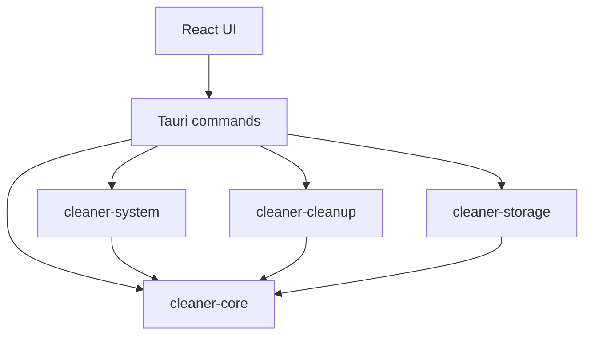

# Архитектура CleanCore

Статус: проект архитектуры, код ещё не реализован. Этапы определяет [ROADMAP](ROADMAP.md); требования безопасности — [ТЗ](../TECHNICAL_SPEC.md).

## Границы

| Слой | Ответственность | Не должен делать |
| --- | --- | --- |
| React UI | Страницы, выбор, подтверждение, отображение результатов | Самостоятельно разрешать файловую операцию |
| Tauri | Узкие команды, валидация, авторизация вызова, сборка сервисов | Предоставлять произвольный shell или путь для удаления |
| cleaner-core | DTO, ошибки, модель риска и интерфейсы задач | Зависеть от React/Tauri/SQLite |
| cleaner-system | Сбор метрик и системных сведений | Изменять систему ради чтения |
| cleaner-cleanup | Правила, preview, повторная проверка, исполнение | Доверять frontend как источнику разрешённых объектов |
| cleaner-storage | Настройки, миграции, журнал | Решать допустимость удаления |

Будущие инструменты анализа и ИИ используют узкие интерфейсы. Отдельные crates создаются по границам ответственности, а не для каждой страницы.

## Зависимости

Сервисы получают зависимости через интерфейсы или явную композицию в Tauri. Например, cleanup получает интерфейс журнала; storage его реализует. Циклических зависимостей нет.

## Владение состоянием

- Сборщик мониторинга владеет долгоживущим экземпляром `sysinfo` и последним снимком. Сборы не перекрываются.
- Реестр задач владеет идентификаторами, прогрессом и сигналами отмены. Тяжёлая синхронная работа выполняется вне UI-потока.
- Cleanup владеет каталогом правил, preview и жизненным циклом операции. Frontend получает представление, а не полномочие обработать произвольный путь.
- Storage сериализует доступ к SQLite. Длительные файловые операции не держат открытую транзакцию на всё исполнение.
- UI хранит состояние отображения и текущий выбор. Все критичные условия повторно проверяет backend.

## Потоки

Мониторинг: сбор → нормализация доступности → снимок → команда UI → отображение.

Очистка: правило → задача scan → preview → выбор → подтверждение → повторная проверка → намерение в журнале → действие → результат в журнале → сводка.

Файловая операция и SQLite не образуют одну атомарную транзакцию. Незавершённый журнал означает неизвестный исход, а не автоматическое повторение.

## Сторонние компоненты

Компоненты подключаются через адаптеры: sysinfo для мониторинга, Windows API для платформенных функций, rusqlite для хранения. Извлечённые части стороннего кода изолируются и документируются в [REUSE](REUSE.md).

## Интерфейс

Общий реестр страниц содержит идентификатор, заголовок и доступность. Незавершённые модули не выдаются за работающие. Общие компоненты отображают загрузку, ошибку, отсутствие данных и устаревший снимок.

## Решения

Изменение границ, добавление привилегий, внешних процессов или новых зависимостей фиксируется по [шаблону решения](templates/DECISION.md). Особенности сериализации — в [API_CONTRACTS](API_CONTRACTS.md).
