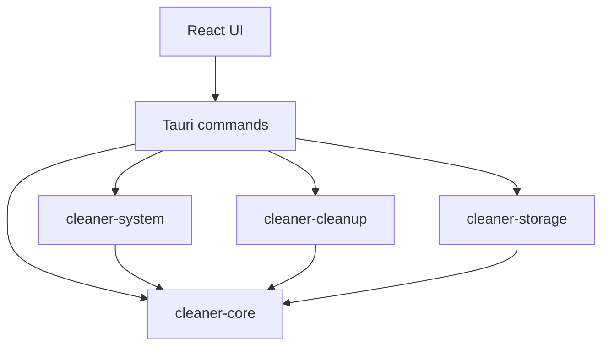

# Архитектура CleanCore

Статус: архитектура реализуемого приложения; незавершённые критерии — в STATUS. Этапы определяет [ROADMAP](ROADMAP.md); требования безопасности — [ТЗ](../TECHNICAL_SPEC.md).

## Границы

| Слой | Ответственность | Не должен делать |
| --- | --- | --- |
| React UI | Страницы, выбор, подтверждение, отображение результатов | Самостоятельно разрешать файловую операцию |
| Tauri | Узкие команды, валидация, авторизация вызова, сборка сервисов | Предоставлять произвольный shell или путь для удаления |
| cleaner-core | DTO, ошибки, модель риска и интерфейсы задач | Зависеть от React/Tauri/SQLite |
| cleaner-system | Сбор метрик и системных сведений | Изменять систему ради чтения |
| cleaner-cleanup | Правила, preview, повторная проверка, исполнение | Доверять frontend как источнику разрешённых объектов |
| cleaner-storage | Настройки, миграции, журнал | Решать допустимость удаления |

Будущие инструменты анализа и ИИ используют узкие интерфейсы. Отдельные crates создаются по границам ответственности, а не для каждой страницы.

## Зависимости

Сервисы получают зависимости через интерфейсы или явную композицию в Tauri. Например, cleanup получает интерфейс журнала; storage его реализует. Циклических зависимостей нет.

## Владение состоянием

- Сборщик мониторинга владеет долгоживущим экземпляром `sysinfo` и последним снимком. Сборы не перекрываются.
- Реестр задач владеет идентификаторами, прогрессом и сигналами отмены. Тяжёлая синхронная работа выполняется вне UI-потока.
- Cleanup владеет каталогом правил, preview и жизненным циклом операции. Frontend получает представление, а не полномочие обработать произвольный путь.
- Storage сериализует доступ к SQLite. Длительные файловые операции не держат открытую транзакцию на всё исполнение.
- UI хранит состояние отображения и текущий выбор. Все критичные условия повторно проверяет backend.

## Потоки

Мониторинг: сбор → нормализация доступности → снимок → команда UI → отображение.

Очистка: правило → задача scan → preview → выбор → подтверждение → повторная проверка → намерение в журнале → действие → результат в журнале → сводка.

Файловая операция и SQLite не образуют одну атомарную транзакцию. Незавершённый журнал означает неизвестный исход, а не автоматическое повторение.

## Сторонние компоненты

Компоненты подключаются через адаптеры: sysinfo для мониторинга, Windows API для платформенных функций, rusqlite для хранения. Извлечённые части стороннего кода изолируются и документируются в [REUSE](REUSE.md).

## Интерфейс

Общий реестр страниц содержит идентификатор, заголовок и доступность. Незавершённые модули не выдаются за работающие. Общие компоненты отображают загрузку, ошибку, отсутствие данных и устаревший снимок.

## Решения

Изменение границ, добавление привилегий, внешних процессов или новых зависимостей фиксируется по [шаблону решения](templates/DECISION.md). Особенности сериализации — в [API_CONTRACTS](API_CONTRACTS.md).

## Параллельный этап 4

Для разделения записи файлов добавлен `cleaner-execution`: он зависит только от `cleaner-core`, владеет preview/confirmations/operations и получает CleanupJournal/ObjectAction через traits. `cleaner-storage` реализует журнал, Tauri собирает сервис. Будущий Rust-сканер может зависеть от `cleaner-execution` без обратной зависимости и циклов. Этот модуль является частью cleanup домена; вынесение связано с параллельной работой, не с отдельным сервисом.

Production ObjectAction — BoundDelete для отдельно подтверждаемого безвозвратного режима; DisabledRecycle остаётся недопущенным адаптером Корзины. [Решение 005](decisions/005-bound-temp-deletion.md). Read-only проверка не выдаёт право на последующее удаление по пути.

## Композиция этапов 1–4 после объединения

TaskManager получает Arc<CleanupService> из AppState. Сканер захватывает TrustedCandidate вместе с метаданными; только полный ограниченный набор публикуется в execution. Scan и execution DTO используют одинаковые object IDs; UI передаёт ID, не пути. DirectoryLease удерживает родителей при read_dir. Пагинация и поиск выполняются в backend. Потоки останавливаются флагом shutdown/cancel при выходе. Production DisabledRecycle не допускает мутацию. [Контракты](API_CONTRACTS.md), [отчёт](reports/STAGES1_4.md).

## Аудит этапов 1–7

cleaner-disk использует Rust-only BoundReader/DirectoryLease из cleaner-execution для
read-only удержания объектов и родителей. Эти интерфейсы не предоставляют удаление.
cleaner-service отвечает за инвентаризацию и фиксированные инструменты Windows.
Экспорт Tauri выбирает путь только через нативный диалог; произвольные webview-пути не записываются.
settings.json — основной источник настроек, SQLite хранит журнал и legacy-копию.
Решение и пределы выпуска: [003](decisions/003-release-candidate.md), [RELEASE](RELEASE.md).

## Локальный помощник

cleaner-assistant зависит от read-only BoundReader из cleaner-execution, но не получает
CleanupService, StorageManager или полномочий изменения системы. assistant_commands
собирает выбранные агрегаты в backend; AssistantPage показывает их перед вопросом.
Отдельный CPU-процесс получает одну сводку по stdin и возвращает ограниченный текст.
Ресурсы и угрозы: [решение 004](decisions/004-local-assistant.md).

## Исполнитель после пользовательских исправлений

AppState теперь подключает BoundDelete для явно названного безвозвратного режима.
DisabledRecycle остаётся недопущенным адаптером Корзины. В отличие от pathname удаления,
BoundDelete проверяет и удаляет один удерживаемый эксклюзивный file handle, удерживая
предков. [Решение 005](decisions/005-bound-temp-deletion.md) заменяет прежний статус
production DisabledRecycle. Автозагрузка получает отдельную узкую HKCU команду,
не универсальный доступ к реестру.

## NTFS MFT и повышение прав

По решению [006](decisions/006-elevated-mft-analysis.md) основной процесс требует UAC. cleaner-disk/ntfs читает raw NTFS metadata, строит один индекс и отчёты подпапок. Этот путь не использует DirectoryLease очистки и не выдаёт полномочия удаления. Обычный обход и дубликаты сохраняют отдельные проверки.
