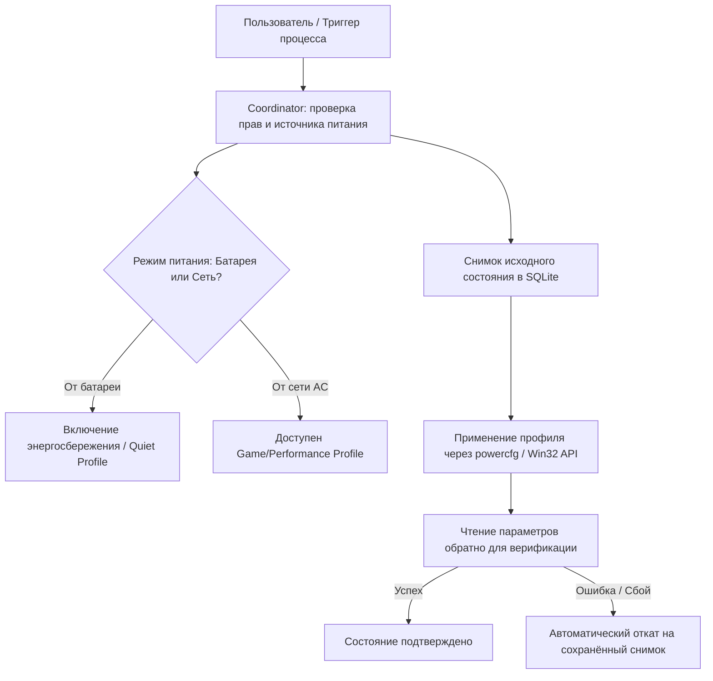

# Спецификация системы оптимизации и обслуживания CleanCore (OPT)

Версия: 1.0.0  
Статус: Архитектурная спецификация и план интеграции  
Связанные документы: [ТЗ](../TECHNICAL_SPEC.md), [ROADMAP](ROADMAP.md), [ARCHITECTURE](ARCHITECTURE.md), [API_CONTRACTS](API_CONTRACTS.md), [SECURITY](SECURITY.md), [THREAT_MODEL](THREAT_MODEL.md)

---

## 1. Введение и концепция

CleanCore развивается от монитора и клинера временных файлов к полноценному центру оптимизации и обслуживания Windows. 

Настоящая спецификация объединяет два ключевых направления:
1. **Интеллектуальная оптимизация накопителя (Smart Disk Optimization):** переход от очистки мелких служебных кэшей к выявлению реальных «пожирателей диска» (Space Hogs, забытые файлы в пользовательских папках, кэши разработчиков, системные залежи Windows).
2. **Оптимизация производительности и электропитания (System Power & Performance Tuning):** перенос проверенных и безопасных наработок из проекта **ZenLap** (управление схемами питания Windows, транзакционный откат настроек, защита ноутбука от разряда батареи и перегрева при тяжёлых сканированиях).

> [!IMPORTANT]
> **Принцип визуальной преемственности:**  
> Дизайн и цветовая схема CleanCore (**Pearl Theme** / жемчужно-серая тёмная палитра) сохраняются полностью. Из проекта ZenLap заимствуются **исключительно архитектурные и технические идеи оптимизации**, математические модели и Win32-механизмы, без изменения визуального языка CleanCore.

---

## 2. Интеллектуальная оптимизация накопителя

Существующий модуль очистки фокусируется на узких категориях (`user-temp-v1`, кэши браузеров). Однако на современных накопителях объёмом 512 ГБ – 2 ТБ место чаще всего исчерпывается не временными файлами программ, а крупными забытыми данными.

### 2.1. Крупные файлы (Space Hogs / Top-N) на базе MFT
Благодаря встроенному парсеру NTFS MFT (`cleaner-disk::ntfs`), CleanCore считывает структуру 2+ млн файлов за секунды. Это позволяет мгновенно формировать срез самых объёмных файлов системы без повторного обхода диска.

* **Критерии выборки:**
  * Порог по размеру: `> 100 МБ`, `> 500 МБ`, `> 1 ГБ`, `> 5 ГБ`.
  * Исключение защищённых системных файлов Windows (`pagefile.sys`, `swapfile.sys`, `hiberfil.sys`, папка `System Volume Information`) — они отображаются информационно, но недоступны для модификации.
* **Категоризация по типам файлов:**
  * **Образы и контейнеры:** `.iso`, `.img`, `.vhd`, `.vhdx`, `.vdi`, `.vmdk`, `.qcow2` (забытые виртуальные машины, дистрибутивы ОС).
  * **Архивы и резервные копии:** `.zip`, `.7z`, `.rar`, `.tar`, `.gz`, `.zst`, `.bak`, `.backup`.
  * **Медиафайлы:** видеомонтажные проекты, несжатые записи OBS, `.mkv`, `.mp4`, `.mov`, `.avi` объёмом более 1 ГБ.
  * **Инсталляторы:** `.msi`, `.exe`, распакованные пакеты драйверов.
* **Интерфейс и действия:**
  * Сортировка по размеру, дате последнего открытия/изменения, расширению.
  * Кнопка «Показать в Проводнике» (`Reveal`).
  * Безопасная подготовка к удалению: только через стандартный подтверждаемый диалог CleanCore с фиксацией в журнале SQLite.

### 2.2. Забытые и неиспользуемые файлы (Stale & Aging Files)
* **Проблема:** Пользователи годами складируют файлы в каталогах загрузок и на рабочем столе, не возвращаясь к ним.
* **Области анализа:**
  * `Downloads` (`FOLDERID_Downloads` через `SHGetKnownFolderPath`).
  * `Desktop` (`FOLDERID_Desktop`).
  * Пользовательские видео и документы.
* **Критерии возраста (на основе меток NTFS `LastWriteTime` и `LastAccessTime`):**
  * Файлы, к которым не обращались более **3 месяцев**.
  * Файлы старше **6 месяцев**.
  * Файлы старше **1 года**.
* **Фильтры безопасности:** Файлы ярлыков (`.lnk`), документы с активными признаками синхронизации (OneDrive/cloud hydration) и скрытые служебные файлы исключаются из автоматических рекомендаций.

### 2.3. Кэши сред разработки и пакетных менеджеров (Dev Caches)
Для программистов и IT-специалистов это основной источник внезапной нехватки дискового пространства:
* **Node.js / Frontend:** каталоги `node_modules`, `.next`, `.turbo`, `.vite`, `.nuxt` в неактивных проектах (проекты, где `package.json` не модифицировался > 60 дней).
* **Rust:** каталоги `target/` в проектах, кэш скачанных крейтов `~/.cargo/registry/cache`.
* **Python:** виртуальные окружения `.venv/`, `env/`, кэш `pip` (`%LOCALAPPDATA%\pip\cache`).
* **Docker / WSL:** образ диска виртуальной машины `ext4.vhdx` (`%LOCALAPPDATA%\Docker` и `%LOCALAPPDATA%\Packages\*WSL*`). CleanCore детектирует реальный размер файла и предлагает штатные команды сжатия (`wsl --compact` / `Optimize-VHD`).

### 2.4. Системные залежи Windows (Deep System Clean)
* **Предыдущие установки Windows:** каталог `C:\Windows.old` (появляется после обновлений Windows 10/11, занимает 15–35 ГБ).
* **Хранилище обновлений Windows:** каталог `C:\Windows\SoftwareDistribution\Download` (очистка возможна при остановленной или неактивной службе обновления).
* **Системные дампы аварийных сбоев:** `C:\Windows\MEMORY.DMP`, файлы в `%LOCALAPPDATA%\CrashDumps` и `C:\Windows\Minidump`.
* **Корзина (Recycle Bin):** подсчёт общего объёма занятого места во всех корзинах томов и вызов штатного безопасного API очистки `SHEmptyRecycleBinW`.

### 2.5. Блок «Быстрые находки» (Smart Insights) на Дашборде
На главной странице (`OverviewPage`) размещается ненавязчивый виджет рекомендаций:
* *«В папке "Загрузки" найдено 14 ГБ файлов, не открывавшихся более полугода»*.
* *«Обнаружено 3 неактивных образа дисков (.iso / .vhdx) суммарным объёмом 26 ГБ»*.
* *«Корзина содержит 9.1 ГБ удалённых объектов»*.
По клику на рекомендацию пользователь мгновенно переходит к отфильтрованному списку с возможностью выбора.

---

## 3. Системная оптимизация производительности (наработки ZenLap)

Из проекта ZenLap CleanCore перенимает концепцию безопасной, измеримой и транзакционной настройки параметров Windows.



### 3.1. Архитектура Power & Battery Awareness (Защита батареи ноутбука)
Тяжёлое сканирование MFT, чтение миллионов записей и расчёт хешей SHA-256 для дубликатов создают колоссальную нагрузку на CPU, шину памяти и контроллер накопителя. На ноутбуке это приводит к быстрому разряду и перегреву.

* **Интеграция Win32 `GetSystemPowerStatus`:**
  В крейт `cleaner-system` добавляется сбор параметров питания:
  * `ACLineStatus`: `0` (от батареи), `1` (от сети), `255` (неизвестно).
  * `BatteryLifePercent`: точный остаток заряда (0–100%).
  * `BatteryFlag`: статус зарядки.
* **Адаптивное поведение клинера (Power-Aware Throttling):**
  * **При работе от батареи:**
    * Параллелизм хеширования дубликатов снижается (1-2 потока вместо `num_cpus`).
    * При заряде `< 20%` фоновые ресурсоёмкие задачи приостанавливаются с понятным уведомлением: *«Сканирование приостановлено для экономии заряда батареи»*.
    * В шапке приложения отображается аккуратный ненавязчивый индикатор: `🔋 38% (Батарея)`.

### 3.2. Управление схемами питания Windows (Power Profiles)
В раздел **«Обслуживание»** (`ServicePage`) добавляется карточка управления системным быстродействием.

Вместо опасных оверклокерских твиков CleanCore использует штатные механизмы Windows Power Management (`powercfg` и Win32 API):

| Профиль | Назначение | Параметры процессора | Поведение системы |
| --- | --- | --- | --- |
| **Quiet / Zen** | Тихая работа, автономность, минимум шума кулеров | Min: 5%, Max: 99% (отключение агрессивного Boost) | Снижение температур на 10–15°C, кулеры не раскручиваются |
| **Balanced** | Стандартный сбалансированный профиль Windows | Min: 5%, Max: 100% | Заводское поведение системы, адаптивные частоты |
| **Performance** | Максимальная стабильность FPS в играх и компиляции | Min: 100%, Max: 100% (только при питании от сети) | Отсутствие микрофризов из-за парковки ядер, максимальная отзывчивость |

### 3.3. Гарантии обратимости и транзакционный откат (Rollback Guarantee)
CleanCore никогда не изменяет параметры питания «навсегда» без возможности возврата:
1. **Снимок (Snapshot):** Перед любой модификацией считываются:
   * GUID активной схемы (`powercfg /getactivescheme`).
   * Значения `PROCTHROTTLEMIN` и `PROCTHROTTLEMAX` для AC и DC.
   * Исходный режим энергосбережения.
2. **Журналирование:** Снимок записывается в таблицу `power_state_history` базы данных SQLite (`cleaner-storage`).
3. **Безопасная смена:** Создаётся временная схема-дубликат (`powercfg /duplicatescheme`), активируется, проверяется повторным чтением.
4. **Откат (Rollback):**
   * При штатном закрытии CleanCore восстанавливается исходная схема.
   * При обнаружении аварийного завершения предыдущего сеанса при следующем запуске программа обнаруживает несохранённое владение и автоматически возвращает исходную схему Windows.
   * Если пользователь вручную переключил схему через панель управления Windows, CleanCore фиксирует внешний конфликт и не пытается насильно переписать выбор пользователя.

### 3.4. Игровой и рабочий Автопилот (Auto-Pilot / Process Watcher)
Автоматическое переключение режима под активную нагрузку:
* Пользователь указывает список целевых приложений (например, `dota2.exe`, `cs2.exe`, `blender.exe`, `devenv.exe`, `code.exe`).
* CleanCore отслеживает запуск процессов через системный монитор (`cleaner-system::processes`).
* При обнаружении целевого процесса:
  * Проверяется источник питания: автопилот активируется **только при питании от сети**.
  * Фиксируется текущий профиль, система плавно переключается в режим **Performance**.
* После закрытия всех отслеживаемых процессов:
  * Система автоматически возвращается в исходный профиль (например, **Balanced** или **Quiet**).

### 3.5. Диагностика троттлинга и OEM-сервисов
В разделе диагностики отображаются реальные системные факторы, влияющие на производительность:
* Статус OEM-служб управления питанием (Lenovo ITS, Intel Dynamic Tuning DTT/IPF, ASUS System Control).
* Детекция троттлинга: сопоставление высокой нагрузки CPU и просадки тактовой частоты.
* Правило достоверности: если датчик температуры пакета недоступен без сторонних драйверов уровня ядра, CleanCore честно пишет `«Датчик температуры недоступен без низкоуровневого драйвера ядра»`, не выдумывая ложные цифры.

---

## 4. DTO и программные контракты (API Contracts)

### 4.1. Модели данных для оптимизации накопителя (`cleaner-core`)

```rust
/// Категория крупного файла
#[derive(Debug, Clone, Serialize, Deserialize)]
pub enum LargeFileCategory {
    DiskImage,    // ISO, VHD, VMDK
    Archive,      // ZIP, 7Z, RAR, TAR
    Video,        // MKV, MP4, MOV
    Installer,    // MSI, EXE
    VirtualDisk,  // WSL, Docker vhdx
    Other,
}

/// Элемент выборки крупных файлов
#[derive(Debug, Clone, Serialize, Deserialize)]
pub struct LargeFileEntry {
    pub id: String,
    pub path: String,
    pub size_bytes: u64,
    pub category: LargeFileCategory,
    pub extension: String,
    pub last_modified_utc: String,
    pub last_accessed_utc: Option<String>,
    pub is_system_locked: bool,
}

/// Находка забытых файлов
#[derive(Debug, Clone, Serialize, Deserialize)]
pub struct StaleFileGroup {
    pub location_name: String,   // "Загрузки", "Рабочий стол"
    pub age_threshold_days: u32, // 90, 180, 365
    pub total_files: u64,
    pub total_size_bytes: u64,
    pub entries: Vec<LargeFileEntry>,
}

/// Быстрая рекомендация на дашборде
#[derive(Debug, Clone, Serialize, Deserialize)]
pub struct SmartInsight {
    pub id: String,
    pub title: String,
    pub description: String,
    pub potential_freed_bytes: u64,
    pub action_type: InsightActionType,
    pub severity: InsightSeverity,
}

#[derive(Debug, Clone, Serialize, Deserialize)]
pub enum InsightActionType {
    OpenSpaceHogs,
    OpenStaleFiles,
    EmptyRecycleBin,
    OpenDevCaches,
}

#[derive(Debug, Clone, Serialize, Deserialize)]
pub enum InsightSeverity {
    Info,
    Notice,
    ActionRecommended,
}
```

### 4.2. Модели данных для телеметрии питания и профилей (`cleaner-core`)

```rust
/// Состояние питания устройства
#[derive(Debug, Clone, Serialize, Deserialize)]
pub struct PowerStatusSnapshot {
    pub is_battery_present: bool,
    pub is_ac_connected: bool,
    pub battery_percent: Option<f64>,
    pub is_charging: bool,
    pub power_save_active: bool,
}

/// Профиль электропитания
#[derive(Debug, Clone, Copy, Serialize, Deserialize, PartialEq, Eq)]
pub enum SystemPowerProfile {
    Quiet,       // Тихий (ограничение буста)
    Balanced,    // Сбалансированный (штатный)
    Performance, // Высокая производительность
}

/// Активное состояние подсистемы питания
#[derive(Debug, Clone, Serialize, Deserialize)]
pub struct PowerTuningState {
    pub active_profile: SystemPowerProfile,
    pub active_scheme_guid: String,
    pub active_scheme_name: String,
    pub cpu_min_throttle_percent: u32,
    pub cpu_max_throttle_percent: u32,
    pub is_managed_by_cleancore: bool,
    pub auto_pilot_enabled: bool,
    pub power_status: PowerStatusSnapshot,
}
```

### 4.3. Новые команды Tauri IPC

* `get_power_tuning_state() -> Result<PowerTuningState, String>` — чтение схемы питания, процентов троттлинга и статуса батареи.
* `set_system_power_profile(profile: SystemPowerProfile) -> Result<PowerTuningState, String>` — транзакционное переключение профиля с сохранением снимка в SQLite.
* `restore_original_power_scheme() -> Result<PowerTuningState, String>` — немедленный откат к схеме, которая была активна до запуска CleanCore.
* `get_smart_insights() -> Result<Vec<SmartInsight>, String>` — сводка быстрых рекомендаций для дашборда.
* `get_space_hogs(min_size_mb: u64, category: Option<LargeFileCategory>) -> Result<Vec<LargeFileEntry>, String>` — выборка тяжёлых файлов из MFT-индекса.
* `get_stale_files(folder_type: String, older_than_days: u32) -> Result<StaleFileGroup, String>` — поиск заброшенных файлов в папках `Downloads` / `Desktop`.
* `empty_system_recycle_bin() -> Result<u64, String>` — вызов штатной очистки корзин всех томов с возвратом освобождённого объёма.

---

## 5. Этапы реализации (Milestones OPT-01 — OPT-06)

| Этап | Название | Задачи | Критерий готовности |
| --- | --- | --- | --- |
| **OPT-01** | **Телеметрия питания (Battery & AC)** | Интеграция `GetSystemPowerStatus`, индикатор батареи в UI, адаптивный троттлинг фоновых задач | Статус батареи и сети виден на дашборде; тяжёлые задачи снижают потоки при питании от батареи |
| **OPT-02** | **Крупные файлы (Space Hogs)** | Быстрая выборка из MFT-индекса, фильтры по категориям (ISO, видео, архивы), таблица в DiskPage | Мгновенный показ Top-100 файлов > 500 МБ без фриза UI; доступно действие Reveal |
| **OPT-03** | **Забытые файлы (Stale Files)** | Сканирование `Downloads` и `Desktop`, анализ `LastAccessTime`, группировка 3/6/12 мес | Обнаружение старых установщиков и архивов с разбивкой по возрасту |
| **OPT-04** | **Кэши разработки и Корзина** | Детектор неактивных `node_modules`, `target/`, venv, вызов `SHEmptyRecycleBinW` | Показ реального объёма Корзины и кэшей сборки с безопасной очисткой |
| **OPT-05** | **Профили питания и транзакции** | Чтение/запись схем Windows через `powercfg`, журнал отката в SQLite, профили Quiet/Balanced/Perf | Профиль переключается; при выходе или сбое восстанавливается исходная схема |
| **OPT-06** | **Автопилот и инсайты** | Процесс-вотчер для игрового/рабочего режима, карточки рекомендаций на OverviewPage | Запуск выбранного exe переключает профиль и возвращает назад при закрытии |

---

## 6. Безопасность и модель угроз

1. **Недопустимость повреждения системных настроек:**
   Любое изменение параметров электропитания изолируется во временную схему CleanCore. Исходные схемы Windows никогда не перезаписываются и не удаляются.
2. **Защита от оверклокинга:**
   CleanCore не осуществляет разгон по шине/множителю, не меняет напряжения (undervolt/overvolt) и не вмешивается в критические пороги срабатывания термозащиты процессора.
3. **Безопасность удаления крупных файлов:**
   Включение файла в категорию «Крупный» или «Забытый» не даёт права на автоматическое удаление. Все действия требуют явного подтверждения пользователя с проверкой занятости файла и отсутствия репарз-точек (junction/symlink).
4. **Конфиденциальность:**
   Вся телеметрия, списки файлов и диагностические снимки хранятся локально в SQLite. CleanCore не производит сетевых запросов и не отправляет телеметрию.
