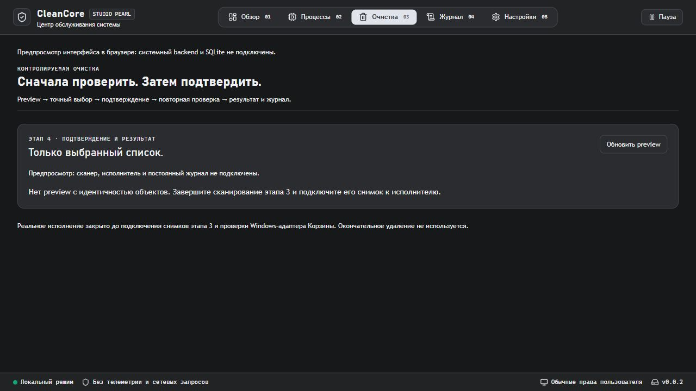

# Отчёт по этапу 4 — параллельная разработка

Дата: 2026-10-14. Статус: компоненты подготовлены и проверены; полная продуктовая приёмка и реальная очистка заблокированы.

## Результат

Создан `cleaner-execution` и отдельный UI в стиле Studio Pearl. Backend хранит неизменяемый preview, подтверждает точный набор, сохраняет все намерения до worker, контролирует одноразовый запуск, отмену и результаты. SQLite сохраняет историю и консервативно восстанавливает неизвестные исходы. Production адаптер Корзины выключен, ни пользовательские файлы, ни настройки ОС этим запросом не удалялись/не изменялись.

Работа изолирована в ветке `codex/stage4-execution`, worktree `C:/Users/dvd/.codex/worktrees/stage4-execution/clean`. Коммит базового снимка `3b64cca` включает ранее существовавшие изменения этапов 1–2 и параллельные наработки этапа 3. Их авторство и готовность не приписываются этапу 4. Автоматического объединения с исходной папкой нет: там работает другая нейронка.

## Модули

| Модуль | Что реализовано | Что ещё требуется |
| --- | --- | --- |
| 4.1 | Пустой начальный выбор, ID-only API, точный список, TTL, последствия, отдельное явное подтверждение | Снимки идентичности из этапа 3, native сценарий |
| 4.2 | Windows read-only handle identity/метаданные/родители, reparse/hard links/sharing checks | Непрерывная привязка при самой операции, junction/ACL/mapping испытания |
| 4.3 | ObjectAction boundary, фоновый worker, безопасный отказ DisabledRecycle | Допущенный Windows-адаптер Корзины; реальное исполнение отсутствует |
| 4.4 | SQLite: атомарные намерения, уникальный preview, per-object исходы, FULL sync, recovery, single-owner lock, порции и журнал UI | Общая интеграция с реальной операцией; компонент проверен отдельно |
| 4.5 | Повторы, конкурентный worker, отмена, отказ журнала до/после действия, panic → Unknown, restart recovery | Общая Windows приёмка активного исполнителя |
| 4.6 | Подтверждение и все исходы, частичный результат, ошибка журнала, объём Корзины отдельно от свободного места | Native GUI и живой сквозной сценарий |

## Изменения и контракты

Wire DTO/trait журнала: `cleaner-core/src/cleanup.rs`. Путь не принимается через IPC. TrustedCandidate создаётся только Rust-кодом после проверки разрешённого корня сканером; идентичность захватывается при scan. Новый выбор аннулирует прежнее подтверждение. Preview живёт 10 минут, подтверждение до 120 секунд, максимум 1000 кандидатов/8 preview. Все байтовые значения — десятичные строки.

Начало операции возвращает ID до завершения worker; polling и отмена доступны по ID. Worker запускается через spawn_blocking. Повторный запуск одного worker/preview запрещён. После ошибки записи намерения действий нет; после ошибки результата пакет останавливается, текущий исход Unknown, дальнейшие объекты остановлены. Паника адаптера также не приводит к повтору.

SQLite миграция добавляет cleanup_operations, не меняет существующие настройки. Намерения хранятся одной транзакцией; каждое обновление коммитится отдельно. На старте Running → Interrupted, незаписанные Pending → Unknown; известные ранее записанные результаты сохраняются. Single-owner `.cleanup.lock` препятствует восстановлению живой операции другим процессом. Fallback in-memory не допускает исполнение.

Компоненты frontend: CleanupExecutionPanel, ConfirmationReview, OutcomeView, AuditHistory. HTML имён файлов экранируется React. После перехода между страницами ID операции сохраняется в sessionStorage, данные операции перечитываются из backend; сам токен подтверждения там не хранится. Журнал читается по 10 операций, UI ограничен 200 операциями на страницу просмотра.

## Проверки

| Команда / сценарий | Код | Результат | Ограничение |
| --- | --- | --- | --- |
| cargo fmt --all --check | 0 | Пройдено | Форматирование |
| cargo clippy --workspace --all-targets --locked -j 2 -- -D warnings | 0 | Пройдено | Общий target cache, без предупреждений |
| cargo test --workspace --locked -j 2 | 0 | 45 пройдено, 1 ignored на итоговом прогоне | 7 core, 9 scanner, 7 system, 12 execution, 10 storage |
| cargo test -p cleaner-storage --locked | 0 | 10 пройдено | Включает новый отказ записи результата; суммарно проверено 45 тестов workspace |
| pnpm typecheck / lint | 0 | Пройдено | lint пока выполняет tsc |
| pnpm test --run | 0 | 14 пройдено | 5 новых IPC/UI тестов, без live native UI |
| pnpm build | 0 | Production Vite пройдено | JS 291.48 kB, gzip 86.67 kB |
| cargo build -p cleancore --locked -j 2 | 0 | Debug desktop-бинарник собран | Не установщик и не выпуск 0.1 |
| Browser 5174: очистка/журнал, refresh preview/history, навигация | неприменимо | Пройдено | Preview без системного backend |
| Browser warn/error logs | неприменимо | Пусто | Для проверенного сценария |
| Реальные Windows файлы: подмена файла/родителя, изменение содержимого, hard links, sharing lock, traversal/ADS | 0 | Пройдено | Изолированные собственные temp-каталоги; только чтение целей проверкой |
| Symlink | ignored | Не пройдено в этом окружении | Создание требует привилегии/Developer Mode; elevation не выполнялось |
| Junction, ACL, memory mapping, отключённый диск, реальная Корзина и последний race перед действием | не запущено | Приёмка не закрыта | Активного адаптера нет |
| Native GUI / Windows 10–11 matrix / DPI | не запущено | Приёмка не закрыта | Native UI automation недоступна |

Фактически cargo-команды полного workspace использовали `--target-dir C:/Users/dvd/Desktop/Projects/clean/target` для повторного использования cache. Отдельные component-тесты также запускались в собственном target worktree. Код и production frontend находятся в отдельном worktree. Один ранний общий запуск компиляции был прерван ОС; повторный запуск с двумя jobs прошёл. Обнаруженные две TypeScript ошибки в новых тестах исправлены, последующая проверка успешна.

## Риски и остаток

Read-only revalidate закрывает дескрипторы до возврата; её нельзя использовать как доказательство безопасности следующего pathname-based действия. Размер и mtime не доказывают неизменность содержания при их принудительном восстановлении. Поддерживаемые файловые системы и гарантии индекса файла (включая ReFS) ещё требуют ограничения и испытаний перед выпуском активного адаптера. Консервативное открытие родителей может исключать доступные файлы; измерения производительности больших preview/журналов не выполнены.

Тестовый ObjectAction моделирует успешные/пропущенные исходы без удаления. Его успех не является тестом настоящей Корзины. Окончательное удаление, смена ACL, shell, elevation, телеметрия и экспорт данных не добавлялись.

## Следующий шаг

Передать другой нейронке [STAGE4_INTEGRATION](../STAGE4_INTEGRATION.md). Объединить отдельный коммит этапа 4 поверх готового этапа 3, сохранить обе группы команд и общий state. Захватить TrustedCandidate во время scan, проверить разрешённый корень и подключить immutable snapshot. Разработать/проверить Windows-адаптер операции с непрерывной привязкой объекта; лишь затем включать исполнение и закрывать полную приёмку.

Новый release-тег не создан, ветка не опубликована. `python scripts/check_docs.py` и `git diff --check` прошли с кодом 0: 125 текстовых файлов, 112 ссылок, 37 таблиц, 54 модуля. Компоненты зафиксированы отдельными локальными коммитами backend и frontend/документации.

## Снимок

