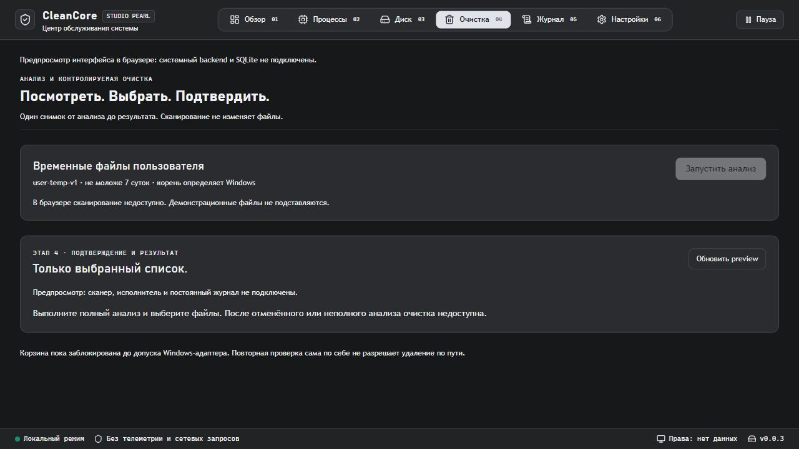

# Повторная проверка и объединение этапов 1–4

Дата: 2026-10-14. Статус: объединено в `codex/stages1-4-integration`; анализ, подтверждение, повторная проверка и журнал связаны. Реальная Корзина выключена, полная приёмка этапа 4 не завершена.

## Результат

Исправления зафиксированы коммитом `51b7189`, итоговая ветка — `codex/stages1-4-integration`. Ветка создана от существующей общей рабочей версии с сохранением файлов этапа 5.

Общая оболочка Studio Pearl, мониторинг, настройки, анализ и журнал работают в одной композиции Tauri. На странице очистки один сценарий: анализ → порционный список → выбор → подтверждение → результат. Полный scan передаёт захваченные во время анализа объекты в execution-preview с теми же Object IDs. Частичный или отменённый анализ не даёт разрешения на исполнение. Этап 5 сохранён; его код и критерии этим отчётом не проверяются.

Компоненты этапа 4 перенесены коммитами `42da025` и `9990b95`. Исходная точка этапа 3 сохранена веткой `codex/stage3-before-integration` (`3f04918`). Общие регистрации команд и capabilities сохранены для обоих модулей.

## Исправления

- Этап 3: вместо доверия TEMP/LOCALAPPDATA — Windows Known Folder; строгая проверка пути, handle идентичности объекта и родителей, удержание каталогов при обходе. Занятые файлы, hard links и reparse points исключаются.
- Явные Partial/Cancelled/Failed, диагностические причины и ограничения: глубина 8, 50 000 записей, 1000 кандидатов, 60 секунд. Ошибки перечисления не превращаются в полный успех.
- Ограниченные реестры задач и снимков, одна активная задача, TTL, обработка ошибок запуска потока и panic. Без переполнения offset и без unwrap на runtime mutex.
- Байты передаются строками без потери точности JavaScript. Поиск выполняется по всему снимку до пагинации. Выбор сохраняется между страницами; изменение выбора сбрасывает подтверждение.
- UI: нет фиктивного browser scan, неопределённый прогресс не изображает процент, запросы не перекрываются и устаревшие ответы отбрасываются. Scan и running operation восстанавливаются после перехода между страницами через sessionStorage.
- Этапы 1–2: реальные сведения о повышении прав либо «нет данных»; честное обозначение SQLite fallback; очистка таймера настроек; остановка фонового мониторинга и отмена scan при выходе.
- Tauri MockRuntime проверяет реальные generated capabilities. Для Windows library-test добавлен common-controls manifest; app binary сохраняет встроенный ресурс Tauri без дублирования.

## Проверки

| Проверка | Результат | Ограничения |
| --- | --- | --- |
| cargo test --locked --offline -p cleaner-core -p cleaner-system -p cleaner-storage -p cleaner-cleanup -p cleaner-execution -p cleancore -j 2 | Код 0; 53 теста пройдено, 1 ignored; doc-tests без ошибок | Symlink требует Developer Mode/привилегии; не включались |
| cargo clippy для тех же пакетов, --all-targets --no-deps -- -D warnings | Код 0 | Без линтинга cleaner-disk |
| Rustfmt, только изменённые файлы этапов 1–4, skip_children | Применён; проверка тем же списком | Без форматирования этапа 5 |
| cargo build --locked --offline -p cleancore -j 2 | Код 0; native debug binary собран | Native GUI не инспектирован |
| pnpm lint, pnpm build | Код 0 | Lint в проекте — TypeScript, не отдельный ESLint |
| Vitest IPC, chart и cleanup-execution | 16 тестов | Без native WebView |
| Browser: обзор, очистка, настройки; console warn/error | Навигация работает, фиктивных файлов и метрик нет; ошибок в просмотренном журнале нет | Проверен browser preview, не native GUI |
| python scripts/check_docs.py, git diff --check | Код 0 | Локальные ссылки, таблицы, соответствие модулей и формат файлов |

13 тестов cleaner-cleanup включают возраст, лимиты, отмену на управляемой точке обхода, запрет публикации неполного снимка, поиск и крайний offset, занятые файлы/hard links, запрет переименования родителя при обходе и Windows junction. Junction создаётся только в собственном UUID fixture; цель вне дерева не изменяется. Сквозной тест scan → confirmation → изменение файла → повторная проверка → persistent SQLite фиксирует пропуск OBJECT_CHANGED, файл остаётся на месте. Тестовый адаптер не выполняет удаление.

Четыре IPC-теста проверяют сохранение настроек, некорректные аргументы, запрет стороннего окна/remote origin/несуществующего shell API, неизвестный выбор и отключённый исполнитель. SQLite-тесты покрывают сбои записи, повторы и восстановление Pending как Unknown.

## Риски и остаток

Production DisabledRecycle остаётся выключенным: read-only handle revalidation не устраняет race между закрытием handle и операцией Корзины по строковому пути. Ни окончательного удаления, ни обходного shell API нет. Для допуска 4.3 нужны доказанная привязка мутации к проверенному объекту, испытания ACL/mapping/занятости и восстановления Корзины, native GUI и матрица Windows 10/11. Symlink-test отдельно пропущен; junction-test его не заменяет. Компиляция и browser preview не означают завершённой приёмки на обеих ОС.

Остаток этапов 1–2: монитор возвращает выбранный диск и агрегированную сеть; приёмка списка всех дисков/адаптеров, больших таблиц, доступности и отзывчивости native GUI под нагрузкой не завершена. Исправления прав, SQLite fallback и shutdown закрывают соответствующие замечания старого walkthrough, но не всю матрицу приёмки.

Переход к последующим этапам не отменяет эти условия допуска. Следующая работа для этапа 4 — безопасный Windows-адаптер и испытания, а не снятие флага DisabledRecycle.
