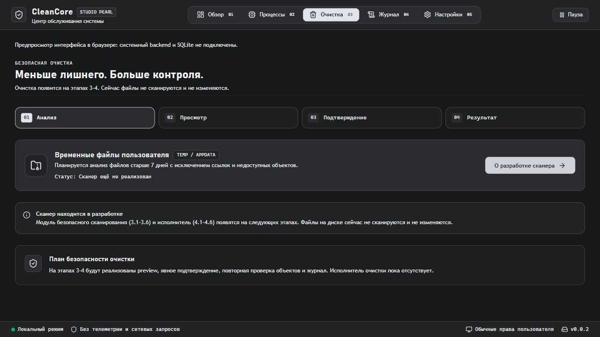

# Повторная проверка этапов 1–2

Дата: 2026-10-14. Статус: каркас и монитор собираются; полная приёмка ещё не закрыта.

## Результат

Изучены backend, frontend, команды, безопасность, сборка и критерии ROADMAP. Исправлены обнаруженные ошибки; отметки завершения в TASKS приведены к фактическим результатам. Файловые операции не добавлялись.

## Изменения

- Tauri: локальный IPC разрешён CSP, собственные команды ограничены AppManifest/capabilities, вызовы сбора переведены в async-команды. Разрешения внешних запросов и shell не добавлялись.
- IPC: ошибки backend передаются вызывающему коду, браузерная заглушка используется только вне Tauri; ошибка подписки видима.
- Монитор: CPU не опрашивается быстрее минимального интервала; процессы ожидают базовый замер. Сеть ожидает второй валидный замер, корректно обрабатывает сброс/исчезновение интерфейса. Агрегат не помечается именем одного адаптера. Нулевая ёмкость диска считается недоступной.
- График: временные координаты по UTC, окно 60 секунд, разрывы для отсутствующих значений.
- SQLite: транзакция для набора настроек, ошибки не подавляются при записи, активные параметры меняются после успешного сохранения. Добавлен тест отката при частичной ошибке записи.
- UI: устранены двойной запрос и повторный опрос пустого списка; очищаются поздние event-подписки, периодические запросы не перекрываются. Ошибки настройки видимы; browser preview не обещает сохранение в SQLite. Заглушка очистки не заявляет реализованные операции.
- CI: удалены проверки наличия файлов на уровне jobs до checkout.

Основание изменения IPC: [официальная документация CSP](https://v2.tauri.app/security/csp/) и [capabilities](https://v2.tauri.app/security/capabilities/).

## Проверки

| Проверка | Результат | Ограничение |
| --- | --- | --- |
| cargo fmt --all --check | код 0 | Форматирование |
| cargo clippy --workspace --all-targets --locked -- -D warnings | код 0 | Без предупреждений |
| cargo test --workspace --locked | код 0, 18 тестов | 7 core, 4 storage, 7 system |
| pnpm typecheck, pnpm test --run, pnpm build | код 0, 9 тестов | 6 IPC, 3 графика |
| cargo build -p cleancore --locked | код 0 | Debug, не установщик |
| Браузер: 5 страниц, пустой список, длинный поиск, обновление, интервал, пауза/возобновление | пройдено | Preview без native IPC |
| Логи browser warn/error | пусто | Для проверенного браузерного сценария |
| pnpm lint | код 0 | Пока только проверка типов tsc |
| python scripts/check_docs.py; git diff --check | код 0 | 90 файлов, 93 ссылки, 34 таблицы, 54 модуля; diff без ошибок |
| Native GUI: IPC, живые показатели, перезапуск с настройками | не проверено | Native UI automation недоступна |
| Windows 10/11, DPI, длительная работа | не проверено | Нет матрицы окружений |

При автоматизации был один таймаут фокуса браузера; после чтения состояния повторная операция завершилась. Это не отмечено как дефект приложения.

## Риски и остаток

1. Модуль 2.3 возвращает один выбранный диск, а не сводку всех дисков.
2. Модуль 2.4 возвращает агрегат, а не показатели каждого адаптера; виртуальные интерфейсы могут учитывать тот же трафик повторно.
3. `AppInfo.is_admin` задан false, фактический токен не проверяется. Запрос повышенных прав отсутствует.
4. SQLite fallback на in-memory и ошибки первоначальной загрузки настроек скрыты от UI; постоянное сохранение в таком режиме не гарантируется.
5. Состояние фонового потока не предусматривает явную остановку; нужна проверка завершения desktop-процесса.
6. DTO TypeScript не генерируются и неполно отражают строковую причину Rust Unavailable. Отдельный frontend линтер отсутствует: lint запускает tsc.
7. Диалоги Radix из задачи 1.4 отсутствуют. Производительность больших таблиц, доступность и совместимость пока не подтверждены.
8. Команды async выносят вызовы из синхронного обработчика, но сами сборщики остаются блокирующими; отзывчивость native GUI под нагрузкой не измерена.

## Снимок интерфейса

Предпросмотр: явное обозначение ещё не реализованной очистки.

## Следующий шаг

Закрыть остаток этапов 1–2 и выполнить native smoke-test до перехода к этапу 3. Эти изменения не опубликованы и не помечены новым release-тегом.
